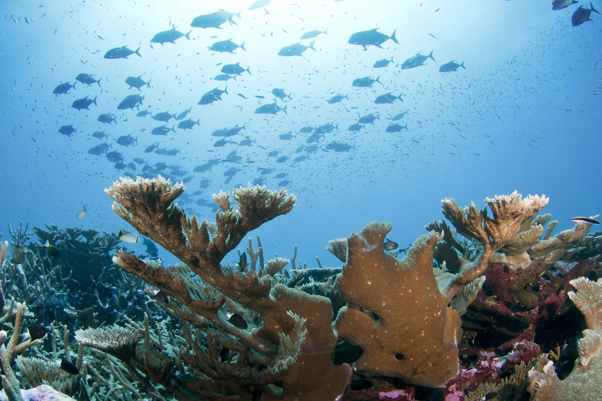
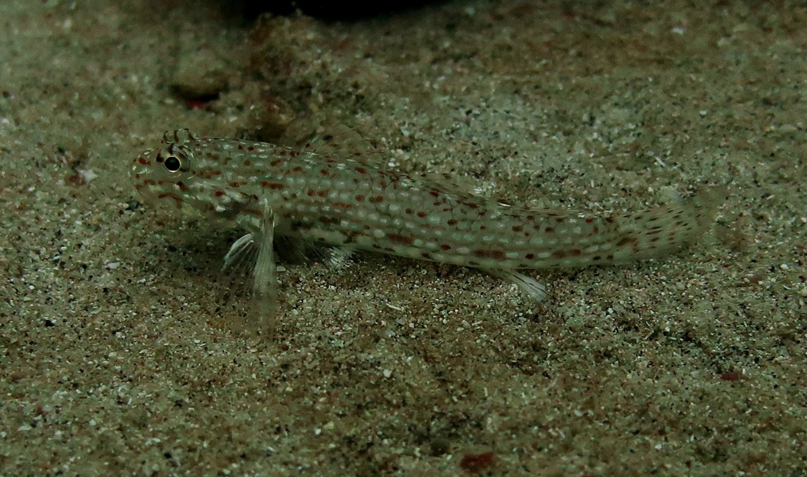
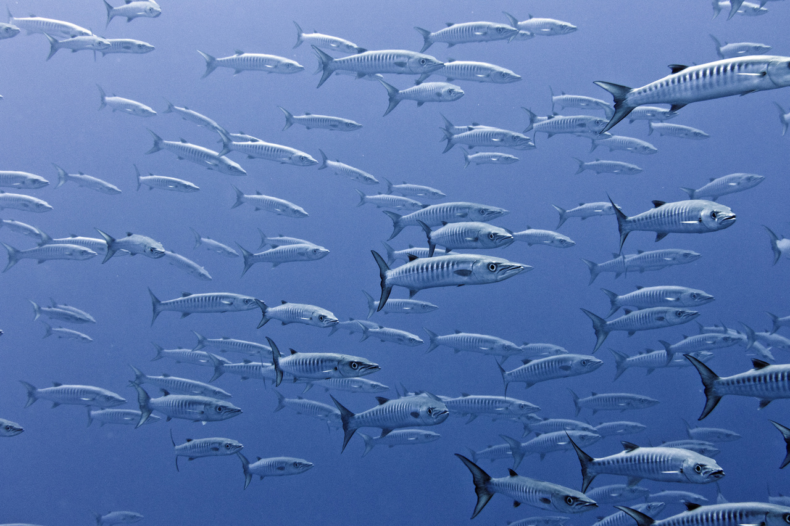

<h1 align="center">UTDR</h1>

<p align="center">
  <b>水下目标识别与检测 · 学习手记</b><br>
  <sub>从一张图像开始，记录概念、实验和自己的判断。</sub>
</p>

<p align="center">
  <a href="#focus">研究兴趣</a> ·
  <a href="#route">学习路线</a> ·
  <a href="#journal">学习日志</a> ·
  <a href="#resources">资料与目录</a> ·
  <a href="#results">成果与总结</a>
</p>

<p align="center">
  
  <br><sub>贝克岛珊瑚礁调查 · <a href="https://www.fisheries.noaa.gov/science-blog/sea-tales-deep-dives-and-shallow-reefs#schooling-jacks">Jeffrey Milisen / NOAA Fisheries</a></sub>
</p>

我是一名准研零学生，开始时只懂一点 Python，每天能学一两个小时。想借这个仓库，慢慢弄清楚计算机怎样从水下图像中认出海洋生物，又怎样在一幅复杂画面里找到它们。

这里会留下每天的笔记、做错的题和跑过的实验。现在的内容还很基础；等独立实验做起来，我也希望这里能展示自己的结果，让别人看得懂我是怎么得出结论的。

## 现在走到哪里了

<!-- LEARNING:SUMMARY:START -->
*最近记录 2026-11-27 · 5 篇笔记*
<!-- LEARNING:SUMMARY:END -->

目前在学**多个样本的平均损失**。今天回答的例题里，B 样本的损失从 1 升到 2，但两个样本的平均损失从 2.5 降到 1.5。因此，不能仅因为某个样本变差，就否定整体训练目标的改善。

前面已经讨论了梯度的更新方向，以及学习率怎样缩放步长。接下来学习数据分批后，一批数据、一次参数更新和一轮训练分别表示什么。

<a id="focus"></a>

## 我想研究的：从看见到认出

先用公开的海洋生物图像学习。这个方向里，我尤其关心**目标识别**：模型凭什么说这是一条鱼，又凭什么把它分到某个类别？认出一个大类和区分外形接近的物种，难度也不一样。

“识别”是一个较宽泛的说法。在这里，先把它落到具体的分类问题上，再学习分类与位置判断怎样一起出现在检测结果里。

| 想回答的问题 | 对应任务 | 结果应该长什么样 |
| --- | --- | --- |
| 给定一张主体明确的图片，它属于哪一类？ | 图像分类 | 一个类别，以及各类别的预测分数 |
| 一张图里有哪些生物，它们在哪里？ | 目标检测 | 每个对象的位置框、类别和预测分数 |
| 某个对象具体占了哪些像素？ | 图像分割 | 对象或类别对应的像素区域，后续按需要再学 |

所以，“识别与检测一体化”首先要理解的是：一次检测结果里，可以同时有**位置与类别**。框画得合适、类别判断正确，是两个都需要检查的问题。这里的任务区分可结合[《动手学深度学习》的检测章节](https://zh.d2l.ai/chapter_computer-vision/object-detection-dataset.html)阅读。

### 水下照片会把问题变得具体

<table>
  <tr>
    <td width="50%" align="center" valign="middle">
      
    </td>
    <td width="50%" align="center" valign="middle">
      
    </td>
  </tr>
  <tr>
    <td valign="top">
      <b>轮廓藏在背景里</b><br>
      <sub>这条虾虎鱼的斑纹与砂砾接近。找到它之后，还需要判断哪些特征能帮助分类。</sub>
    </td>
    <td valign="top">
      <b>一幅画面里有很多对象</b><br>
      <sub>鱼群中有远有近，也有遮挡。“图里有鱼”还没有回答每条鱼在哪里。</sub>
    </td>
  </tr>
</table>

<sub>左：Louise Giuseffi / NOAA Fisheries；右：Jeff Milisen / NOAA Fisheries。照片用于观察与说明，未经模型预测。[原文与素材说明](docs/design.md)</sub>

后面看实验时，我想把注意力放在这些具体问题上：哪些类别总被认混，背景变化后还能不能认对，模糊或被遮住的对象该怎样描述。模型给出的高分，也需要和真实标签对照，才能知道它是否可靠。

<a id="route"></a>

## 接下来怎么学

学习顺序会按实际理解情况调整。每天能推进一个小问题就够了，下面几步也可以反复来回走。

### 先弄懂模型怎样学习

从样本、特征、标签和训练过程开始，接着学数据划分、过拟合与评价。遇到损失函数和梯度下降，再补相关的向量、概率和求导。我希望自己能解释一个公式在计算什么，知道某个结果是在什么条件下得到的。

这一段会留下概念笔记和小例题。当前的[机器学习笔记](machine_learning/README.md)会继续往这里补。

### 用分类理解“识别”

先在规模适中的教学数据上完成一次分类实验，读懂输入、标签、模型输出和训练曲线，再学习神经网络与卷积。之后根据数据条件，选择公开海洋生物资料做分类练习。

除了一个总准确率，我还想看每个类别的表现，以及哪些类别容易互相认错。这个阶段希望留下第一份完整实验报告，里面有数据说明、实际结果和错误样本。

### 把对象放回完整画面

有了分类基础，再学习目标框、标注和检测结果的含义。在公开民用海洋观测图像中，分别观察漏掉的对象、认错的类别和不合适的位置框。需要像素轮廓时，再进一步了解分割。

这一阶段的成果会同时展示原图、标注和预测结果，并写清评价条件。现在还没有开始这部分实验。

### 再决定要不要增加输入

我最初就好奇，多模态数据融合会不会更好。这个问题先留着：照片、水下声音和声学图像记录的信息不同，两份资料也未必对应同一个时间、地点或对象。

等单一图像的学习和数据说明做扎实后，再了解公开海洋观测中的其他传感器资料。是否继续做视频观察或多模态，取决于能拿到什么数据，以及它是否真的能回答一个具体问题。

更细的主题顺序、每天的安排和阶段检查放在[学习路线](docs/learning-guide.md)。

## 我准备怎样学习和记录

我更想把时间花在理论理解上。一般先读一个概念，画图或手算一个小例子，再用少量代码核对。能解释输入输出、看懂关键计算、改一个设置并检查结果，是现阶段对代码的要求。

AI 可以帮我写辅助代码、解释报错和整理表达。我需要自己判断数据怎么分、指标说明什么、结论有没有证据；笔记里也会保留自己的原始回答，方便以后回头看。

每天大致留出 40～60 分钟学概念，20～30 分钟读代码或做小实验，最后用 10 分钟记下一个新理解和一个没弄懂的问题。时间不够就拆成两天，遇到公式也可以多停几天。

<a id="journal"></a>

## 学习日志

<!-- LEARNING:RECENT:START -->
- 2026-11-27 · [平均损失：个别样本变差，整体仍能改善](journal/2026/2026-11-27.md)
- 2026-11-26 · [准确率、损失与参数：预测怎样变化](journal/2026/2026-11-26.md)
- 2026-11-25 · [过拟合与欠拟合：为什么选择第 30 轮](journal/2026/2026-11-25.md)
<!-- LEARNING:RECENT:END -->

有次用切片在黑色画布上画矩形，我数对了 6 个白色像素，却把位置写偏了一行一列。这样的错误也会留下来；以后再遇到同类问题，可以检查自己到底改掉没有。

[查看全部记录](journal/README.md)

<details>
<summary>每天怎样添加一篇笔记</summary>

在仓库根目录生成当天的草稿。

```powershell
python scripts/new_entry.py --topic "今天学习的问题"
```

写完后，把文件顶部的 `status: draft` 改成 `status: recorded`，然后刷新日志和首页。

```powershell
python scripts/new_entry.py --refresh
```

首页显示最近三篇记录，完整历史保留在日志索引里。[完整更新说明](docs/maintenance.md) · [每日笔记模板](templates/daily.md)

</details>

<a id="resources"></a>

## 资料与仓库目录

先围绕一份主教材学习，遇到实现细节再查官方文档。后续读过的论文，也会记录它回答了什么问题、用了什么数据，以及哪些结论我还没有验证。

| 资料 | 准备怎样使用 |
| --- | --- |
| [《动手学深度学习》中文版](https://zh.d2l.ai/) | 主教材，按当前主题选择基础、数学与图像章节 |
| [PyTorch 基础教程](https://docs.pytorch.org/tutorials/beginner/basics/intro.html) | 开始神经网络实验时，对照理解数据和训练过程 |
| [TorchVision 检测教程](https://docs.pytorch.org/tutorials/intermediate/torchvision_tutorial.html) | 分类基础之后再读，先认识标注和输出的结构 |
| [MBARI · FathomNet](https://www.mbari.org/data/fathomnet/) | 后续调查海洋生物图像与标注的入口，尚未选定实验数据 |

选数据时，会先记下来源和使用许可，再看类别、标注方式与采集背景。首页的照片是阅读配图；后续的训练与评价数据，会另写数据说明。

<details>
<summary>仓库里的内容放在哪里</summary>

| 入口 | 内容 |
| --- | --- |
| [journal](journal/README.md) | 按日期保存的理解、练习与纠错 |
| [python_basic](python_basic/README.md) | 早期 Python 练习，遇到语法问题时回查 |
| [numpy_basic](numpy_basic/README.md) | 图像数组、索引与裁剪示例 |
| [machine_learning](machine_learning/README.md) | 理论学习与已有读书笔记 |
| [showcase](showcase/README.md) | 有证据的阶段成果与总结 |
| [templates](templates/daily.md) | 每日笔记和[实验报告模板](templates/result.md) |

新实验会单独保存数据说明、运行方法与结果，完成后再从首页和成果档案链接过去。[历史路线归档](docs/archive/README-before-2026-11-24.md)保留了早期的想法。

</details>

<a id="results"></a>

## 成果与阶段总结

现在能展示的是基础理解与课程练习。以后每完成一个实验，会把能复查的结果补在这里，也保留没有做好的部分。

### 已有记录：一张图像怎样变成数组

第一课里，我正确回答了像素索引和裁剪后数组的形状；矩形起止位置的错误也已记下。下面用同一课的数组演示 `gray[0:2, 1:4]`：留下前两行、第 2 到第 4 列，结果是两行三列。


<sub>课程示例动画，播放一次后停在结果处。也可以查看[静态图](assets/images/array-crop.png)。</sub>

[完整练习与纠错](journal/2026/2026-11-16.md) · [可运行的示例](numpy_basic/lesson01_image_arrays.py)

### 已有记录：为什么选择模型 B

我能把模型选择与未见过的数据联系起来。在例题的同等评价条件下，我优先选择验证表现更好的 B。这个判断来自例题分析，独立训练和评价实验还没有完成。

[原始回答与分析](journal/2026/2026-11-24.md)

### 已有记录：判断过拟合与欠拟合

在[过拟合与欠拟合的判断记录](journal/2026/2026-11-25.md)中，保留了两次原始回答，以及根据验证表现选择第 30 轮的分析。

### 已有记录：准确率不变，损失也能下降

在猫狗分类例题中比较了交叉熵损失，也修正了对单个样本损失的表述。随后用一个数值预测例子，观察参数调整的方向和幅度怎样影响损失。[原始回答与计算示例](journal/2026/2026-11-26.md)

### 已有记录：一个样本变差，平均损失仍能下降

在[平均损失的判断记录](journal/2026/2026-11-27.md)中，保留了自己的回答，并把“总体”具体到题目中两个样本的平均损失。

### 后面希望在这里展示什么

| 计划成果 | 完成后展示的内容 | 目前状态 |
| --- | --- | --- |
| 第一份分类实验报告 | 数据划分、结果、混淆情况与错误样本 | 待开始 |
| 海洋生物图像识别记录 | 类别说明、真实预测图与容易认错的情况 | 待选数据 |
| 完整画面的检测观察 | 标注与预测的对照，漏检和错分的分析 | 后续学习 |
| 阶段回顾 | 独立完成了什么，哪些判断改变了，仍有哪些局限 | 随实验积累 |

我希望最后拿出来的作品，能让别人顺着数据、方法和结果复查一遍，也能看出我自己的工作在哪里。第一次实验的结果即使不好，也值得把原因写清楚。

[进入成果档案](showcase/README.md) · [使用实验报告模板](templates/result.md)

---

<sub>UTDR · 持续更新的个人学习记录。照片署名、来源与动画说明见[素材说明](docs/design.md)。</sub>
