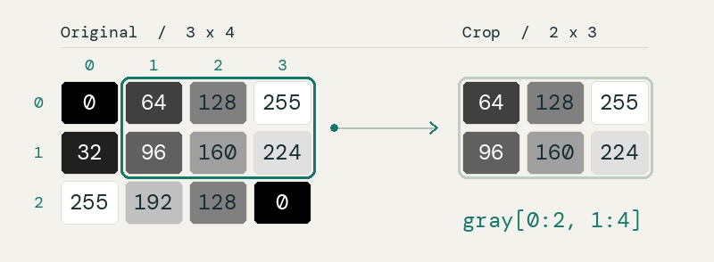

# UTDR · 水下感知学习笔记

我是一名准研零学生，开始时只懂一点 Python。这个仓库记录我怎么从图像数组和机器学习基础学起，再慢慢走到公开民用海洋观测里的问题。平时每天能学一两个小时，我会把做过的题、跑过的例子，还有后来改过的想法写在这里。

[学习日志](journal/README.md) · [学习路线](docs/learning-guide.md) · [成果档案](showcase/README.md)


<sub>贝克岛珊瑚礁调查。摄影 <a href="https://www.fisheries.noaa.gov/science-blog/sea-tales-deep-dives-and-shallow-reefs#schooling-jacks">Jeffrey Milisen / NOAA Fisheries</a>。</sub>

最开始我好奇的是，多一种数据会不会让模型判断得更准。后来发现，连两份数据是不是在记录同一件事，都得先弄清楚。比如一张鱼群照片和一段水下录音，即使都来自海里，也可能来自完全不同的时间和地点。我现在先选一种容易上手的输入，从能看懂的图像开始，再回头想怎么比较两种数据。

## 最近在学什么

<!-- LEARNING:SUMMARY:START -->
*最近记录 2026-11-24 · 2 篇笔记*
<!-- LEARNING:SUMMARY:END -->

目前在学**泛化和模型评价**。有道例题里，模型 A 在训练集上有 99% 的准确率，在验证集上只有 72%。模型 B 的训练准确率是 91%，验证准确率有 87%。按同样的数据划分和评价方式比较，我会先选 B，因为要预测的是训练时没见过的样本。

如果验证集里混入了和训练集重复的样本，验证分数还可信吗？下一步我想先弄清三个数据集的分工，再用一个小例子看看数据泄漏会怎样影响分数。

## 学习日志

<!-- LEARNING:RECENT:START -->
- 2026-11-24 · [泛化：为什么我选择模型 B](journal/2026/2026-11-24.md)
- 2026-11-16 · [图片为什么是数组](journal/2026/2026-11-16.md)
<!-- LEARNING:RECENT:END -->

我会把最初的回答也留下来。有次用切片在黑色画布上画矩形，我数对了 6 个白色像素，却把位置写偏了一行一列。下次做同类题，我打算先在图上标出起点和最后一个要取的位置，再写切片。

<details>
<summary>添加一篇学习记录</summary>

在仓库根目录生成当天的草稿。

```powershell
python scripts/new_entry.py --topic "今天学习的问题"
```

写完后，把文件顶部的 `status: draft` 改成 `status: recorded`，然后刷新日志和首页。

```powershell
python scripts/new_entry.py --refresh
```

[完整更新说明](docs/maintenance.md) · [每日笔记模板](templates/daily.md)

</details>

## 接下来怎么学

**先把模型评价讲明白。** 除了样本、特征、标签这些基础概念，我想搞懂什么时候用训练集、验证集和测试集，为什么训练得越好有时反而越容易在新样本上出错。之前留在[机器学习目录](machine_learning/README.md)里的读书笔记，可以边学边回看。

**学到公式时，找一个小例子算一遍。** 遇到损失函数和梯度下降，我会先补够用的向量、概率和求导，再去读实现里真正影响结果的几行代码。之前的[Python 练习](python_basic/README.md)还在，遇到陌生的数组操作就回来查。

**做完一个小实验，再考虑更复杂的数据。** 先用教学数据完整做一次分类实验，从数据划分到结果解释都走一遍。再找合适的公开民用海洋数据，看看换到真实图像后，类别、画面质量和标注会带来哪些新问题。

我会把更多时间放在理解上。代码能帮我检验猜想，比如改一个设置后，先写下我预计会发生什么，再去看输出。几行关键代码能读懂、能改、知道怎么检查，就值得记下来。

## 成果与阶段总结

**图像裁剪。** 我能读懂灰度数组的高和宽，看出切片会留下哪些像素。下面这段动图用的是第一课里的例子，青色区域对应 `gray[0:2, 1:4]`，裁剪后有两行三列。



[完整练习与纠错](journal/2026/2026-11-16.md) · [静态图](assets/images/array-crop.png) · [可运行的示例](numpy_basic/lesson01_image_arrays.py)

**模型选择。** 我能解释为什么在例题里选 B，也能说清这个判断依赖同样的评价条件。原题分数和我当时的回答都保存在笔记里。[泛化学习记录](journal/2026/2026-11-24.md)

**第一个独立分类实验 · 待完成。** 希望最后能拿出一份自己跑过、别人也能复现的报告，写清用了什么数据、怎样划分、模型在哪些样本上容易出错。完成后会把实际结果和运行方法放在这里。[成果档案](showcase/README.md) · [实验报告模板](templates/result.md)
