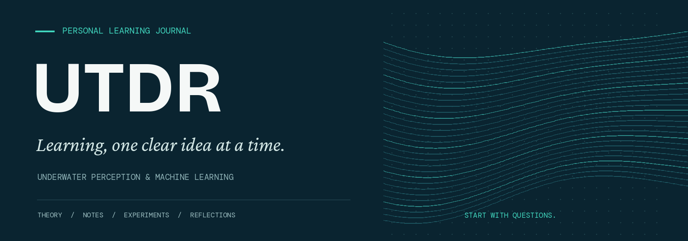
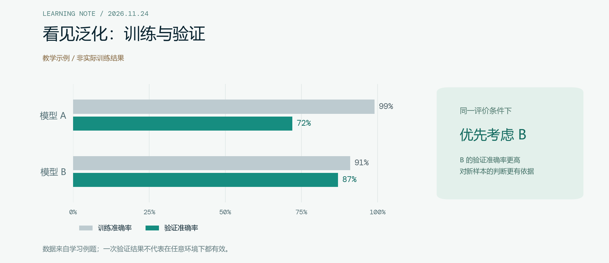

<p align="center">
  <strong>一个准研零学生的学习成长记录</strong><br>
  理解原理 · 记录思考 · 验证结论 · 展示成长
</p>

<p align="center">
  <a href="#now">当前进度</a> ·
  <a href="#journal">每日记录</a> ·
  <a href="#path">学习路线</a> ·
  <a href="#library">笔记与代码</a> ·
  <a href="#results">成果与成长</a>
</p>

---

这里记录我从一点 Python 基础出发，学习数学、机器学习与计算机视觉的过程。长期关注公开民用场景下的海洋观测与水下感知，当前先建立扎实的通用理论基础。

我希望每一次更新都能留下一个清楚的问题、一段自己的理解，或一份可以复查的证据。

<a id="now"></a>

## 01 / 我正在学什么

<!-- LEARNING:SUMMARY:START -->
| 已整理学习记录 | 记录草稿 | 最近记录 |
| :---: | :---: | :---: |
| **2 篇** | **0 篇** | **2026-11-24** |
<!-- LEARNING:SUMMARY:END -->

**当前主题：泛化与模型评价。** 我已经能根据同一划分下的训练、验证表现解释模型选择；接下来学习数据划分、过拟合与数据泄漏。

> **最近的一点理解**
>
> “更倾向于模型 B，因为我们在现实生活中更多的是预测一些没有碰到过的情况。”
>
> —— 2026-11-24 的学习回答；完整讨论见[当日记录](journal/2026/2026-11-24.md)。

<a id="journal"></a>

## 02 / 每日学习记录

每篇记录保留：**今天的问题 → 我的理解 → 证据与验证 → 修正与疑问 → 下一步**。

<!-- LEARNING:RECENT:START -->
| 日期 | 学习主题 | 记录状态 |
| --- | --- | --- |
| 2026-11-24 | [泛化：为什么我选择模型 B](journal/2026/2026-11-24.md) | 已整理 |
| 2026-11-16 | [图片为什么是数组](journal/2026/2026-11-16.md) | 已整理 |
<!-- LEARNING:RECENT:END -->

[查看全部记录 →](journal/README.md) · [每日记录模板](templates/daily.md)

<a id="path"></a>

## 03 / 以理论为主线

| 阶段 | 我想弄懂的问题 | 留下的证据 | 进度 |
| --- | --- | --- | --- |
| 数据与图像 | 图片怎样表示？样本和标签是什么？ | 图像数组笔记、切片解释 | 已开始 |
| 学习与泛化 | 学得好，为什么不一定预测得好？ | 模型选择判断、数据划分笔记 | 当前重点 |
| 数学与优化 | 损失怎样衡量误差？梯度怎样更新参数？ | 必要公式的解释、小实验 | 待学习 |
| 神经网络与视觉 | 特征、卷积和网络各自在做什么？ | 结构图、关键代码解读 | 待学习 |
| 实验与表达 | 怎样证明结论可靠，并把过程讲清楚？ | 对照实验、结果报告 | 待实践 |

每天约 1～2 小时，理论和推理占主要时间，代码用于检验理解。完成一个主题后再前进。[详细路线与学习方式 →](docs/learning-guide.md)

<a id="library"></a>

## 04 / 笔记与代码

| 入口 | 内容 |
| --- | --- |
| [学习日志](journal/README.md) | 按日期整理的问题、回答与复盘 |
| [Python 早期练习](python_basic/README.md) | 数组、统计、绘图与随机噪声练习 |
| [图片与数组](numpy_basic/README.md) | 灰度、RGB、索引与裁剪，可运行的示例 |
| [机器学习基础](machine_learning/README.md) | 泛化、模型选择与已有读书笔记 |
| [成果档案](showcase/README.md) | 带证据的成长记录与未来实验报告 |

<details>
<summary><strong>展开：怎样给这个仓库增加一天的学习内容</strong></summary>

1. 在项目根目录执行下面的命令，生成当天的记录草稿。
2. 填写自己的理解、证据和疑问；内容整理好后，把文件顶部的 `status: draft` 改为 `status: recorded`。
3. 刷新索引，再通过 Git 提交修改。

```powershell
python scripts/new_entry.py --topic "今天想弄懂的问题"
python scripts/new_entry.py --refresh
```

同一天继续学习时，直接编辑已有记录。脚本使用北京时间命名文件，并保护已有笔记。也可以[手动复制模板](templates/daily.md)。[完整使用说明 →](docs/maintenance.md)

</details>

<a id="results"></a>

## 05 / 我的成果与成长

### 已经留下的证据

| 01 · 从数字理解图片 | 02 · 从分数理解泛化 |
| --- | --- |
| 能正确解释例题中的像素位置与裁剪形状；补充了切片索引偏移的纠错记录。 | 能说明为什么在相同评价条件下优先考虑验证表现更好的模型 B。 |
| [学习记录](journal/2026/2026-11-16.md) · [图像示例](numpy_basic/lesson01_image_arrays.py) | [学习记录与本人回答](journal/2026/2026-11-24.md) · [概念图](assets/images/generalization.png) |



*图中的 99%、72%、91%、87% 来自学习例题，用于解释概念，不代表训练成果。*

### 下一件值得展示的成果

**第一个独立、可复现的小实验 · 待完成**

完成后，这里会展示问题、方法、真实结果图、运行方式和失败分析。现阶段已经留下的证据是基础理解与学习示例，独立训练结果将在实际完成后加入。

[打开成果档案 →](showcase/README.md) · [使用成果报告模板](templates/result.md)

---

<p align="center"><sub>UTDR · 把每天的理解，积累成可以展示的成长。</sub></p>
