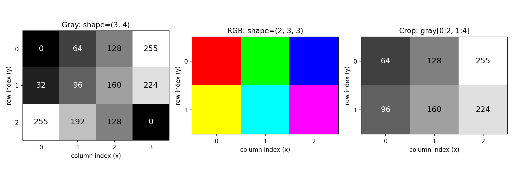

# 图片为什么是数组

**2026-11-16 · 图像表示与 NumPy**

[← 全部记录](../README.md) · [完整讲义](../../numpy_basic/README.md) · [示例代码](../../numpy_basic/lesson01_image_arrays.py)

## 今天的问题

图片怎样用数字表示？数组的形状、像素位置和裁剪区域分别是什么意思？

## 我的理解与回答

在本课的 8 位灰度图像中，每个数表示一个像素，取值为 0～255。灰度数组按 `(高, 宽)` 排列，本课的 RGB 数组按 `(高, 宽, 通道)` 排列。

面对下面的数组：

```text
[[  0  64 128 255]
 [ 32  96 160 224]
 [255 192 128   0]]
```

我给出的回答：

> `gray[2, 1]` 是 192，对应第三行第二列。
>
> `gray[1:3, 0:2]` 取出 32、96、255、192，结果的 shape 是 `(2, 2)`。

这两项回答已核对。第二项保持二维排列时是：

```text
[[ 32  96]
 [255 192]]
```

## 证据与验证



配套示例已运行验证，能保存 PNG、重新读取像素，并输出裁剪结果；这是课程示例的运行记录。

```powershell
python numpy_basic/lesson01_image_arrays.py
```

## 修正与疑问

**2026-11-24 补记：** 矩形练习中，我正确判断白色区域有 6 个像素，但将行索引 `2、3`、列索引 `3、4、5` 写成了 `canvas[1:3, 2:5]`，位置偏移了一行一列。对应的切片应为：

```python
canvas[2:4, 3:6] = 255
```

需要继续注意：日常说的“第几行”和从 0 开始的索引不同；切片包含起点，不包含终点。独立保存矩形图片的练习尚未在这份记录中验证。

## 下一步

把代码阅读放在理论理解的背景下，接着学习模型怎样学习，以及为什么要关心新数据上的表现。

## 资料

- [NumPy 官方初学者指南](https://numpy.org/doc/stable/user/absolute_beginners.html)
- [Pillow 图片操作教程](https://pillow.readthedocs.io/en/stable/handbook/tutorial.html)
