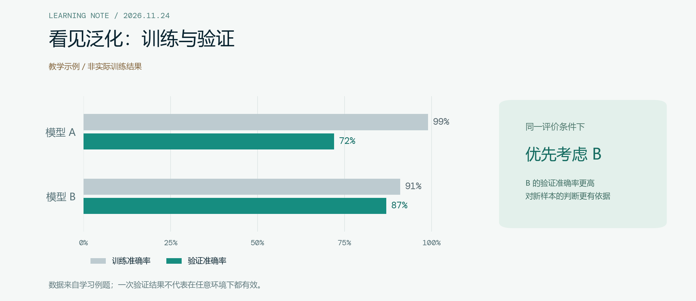

# 泛化：为什么我选择模型 B

**2026-11-24 · 机器学习基础**

[← 全部记录](../README.md) · [成果档案](../../showcase/README.md)

## 今天的问题

如果训练集上表现更好的模型，在验证集上表现更差，我应该怎样选择？

| 模型 | 训练准确率 | 验证准确率 |
| --- | ---: | ---: |
| A | 99% | 72% |
| B | 91% | 87% |

前提：使用相同的数据划分和评价方式。这些数字是教学例题，不是运行训练得到的结果。

## 我的判断

> 更倾向于模型 B，因为我们在现实生活中更多的是预测一些没有碰到过的情况，所以综合考虑训练准确率后优先考虑泛化能力更强的模型，即 B。

这个回答抓住了模型选择的重点：关注未参与训练的数据上的表现。

## 整理补充：泛化与数据划分

泛化指模型在未见过的数据上的表现。训练准确率说明模型对已有训练样本的拟合情况；验证集帮助我们在开发过程中比较方案；测试集通常用于方案确定后的最终评价。

本例中，B 的验证准确率更高、训练与验证的差距也更小，因此在这些信息和评价条件下优先考虑 B。两者差距较大是检查过拟合的线索，但不能仅靠一张分数表确定所有原因。

本例的训练与验证准确率差值分别是 27、4 个百分点。差值是辅助观察，评价时仍需要关注验证表现本身及评价条件。

## 对自己判断的进一步修正

“未见过的样本”与“完全不同分布的情况”有区别。一次验证集上表现更好，只能为相应评价条件下的泛化提供证据；还不能证明模型对任意环境都有效。

## 学习方式的调整

我希望优先建立理论基础，能够解释、修改并验证关键代码。完整实现可以借助工具，关键概念与实验判断需要自己理解。

后续学习以理论、图示和必要公式为主，配少量用于验证概念的代码。

## 证据与验证

- 已完成：对模型 A、B 的选择及理由说明。
- 已整理：训练、验证、测试的基本职责。
- 待验证：亲自完成一次合理划分数据的小实验。

## 下一步

- 为什么需要分开训练集、验证集和测试集？
- 哪些操作会导致数据泄漏？
- 验证分数的波动会怎样影响判断？

## 资料

[《动手学深度学习》：模型选择、欠拟合和过拟合](https://zh.d2l.ai/chapter_multilayer-perceptrons/underfit-overfit.html)
