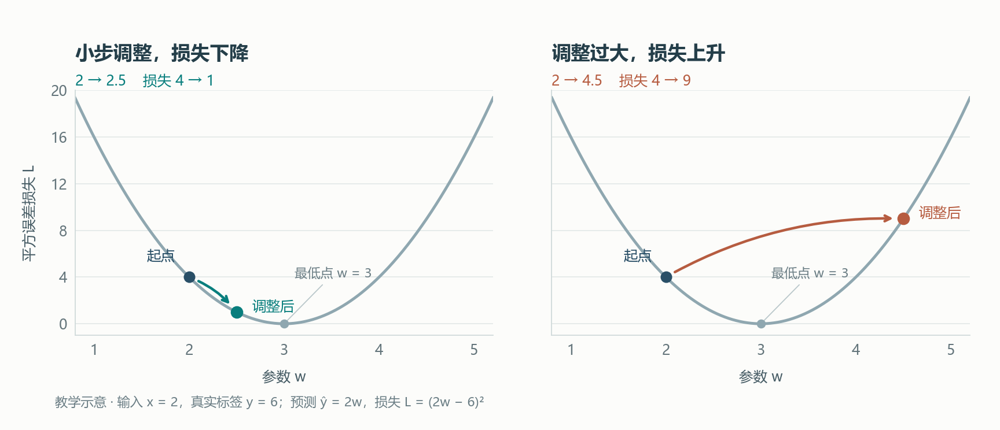

# 准确率、损失与参数：预测怎样变化

**2026-11-26 · 机器学习基础**

[← 全部记录](../README.md) · [成果档案](../../showcase/README.md)

## 今天的问题

两个模型都把图片认对了，它们的预测有什么区别？训练时怎样用一个数值衡量预测与真实标签的差异？

今天先用猫狗分类例题学习准确率和交叉熵损失，再用单参数的数值预测例子理解参数更新。所有概率与损失值都是教学示例，没有运行模型训练。

## 概念整理

准确率统计预测正确的比例。例如，100 张图片认对 90 张，准确率为 90%。它会把每个样本记作正确或错误，不体现模型给各类别的具体概率。

对于真实类别为猫的图片，给猫 51% 和 99% 的预测概率，都可以得到正确的类别判断。但这两次预测的交叉熵损失不同。

本课的单标签分类例题使用以下单样本交叉熵公式：

`L = -ln(p_true)`

`p_true` 是模型给真实类别的预测概率，`ln` 表示自然对数。在 `0 < p_true ≤ 1` 时，概率越接近 1，损失越接近 0；概率越接近 0，损失越大。

预测概率是模型给出的估计值。今天比较的是给定样本上的损失，完整模型的评价还要看其他样本及评价条件。

训练时，通常通过调整参数减小训练数据上的平均损失。验证集也可以计算损失，帮助观察新数据上的表现。

## 第一题：都判断错了，谁的损失更大

图片的真实类别为猫，选择预测概率较大的类别作为最终判断。

| 模型 | 猫的预测概率 | 狗的预测概率 | 最终判断 | 单样本交叉熵损失 |
| --- | ---: | ---: | --- | ---: |
| C | 1% | 99% | 狗，错误 | 约 4.605 |
| D | 40% | 60% | 狗，错误 | 约 0.916 |

### 我的原始回答

> C更大，因为他的正确预测概率更低

### 课堂核对与补充

判断正确。更具体地说，C 给真实类别“猫”的预测概率更低，因此损失更大。C 非常确信地给出了错误类别，交叉熵会给出较大的代价。

## 第二题：准确率没变，损失怎样变化

仍然是同一张真实类别为猫的图片：

| 阶段 | 猫的预测概率 | 狗的预测概率 | 最终判断 | 单样本交叉熵损失 |
| --- | ---: | ---: | --- | ---: |
| 调整参数前 | 60% | 40% | 猫，正确 | 约 0.511 |
| 调整参数后 | 80% | 20% | 猫，正确 | 约 0.223 |

### 我的原始回答

> 准确率没变，但是两个的交叉熵都降低了

### 表述修正

主要判断正确：只看这张图片，前后都预测正确，准确率没有变化；调整后给真实类别的概率更高，损失降低。

更准确的表述是：“这张图片的交叉熵损失从约 0.511 降到了约 0.223。”这里比较的是同一个样本在两个阶段各自的一个损失值。

本题按真实类别“猫”的概率计算损失，不把猫和狗分别当作真实标签各算一次。

## 继续学习：参数怎样影响预测与损失

参数是训练时需要学出来的数值。用一个简单的数值预测模型观察这个过程：

`ŷ = wx`

输入为 `x = 2`，真实标签为 `y = 6`，可调整参数为 `w`。这里使用平方误差损失 `L = (ŷ - y)²`；它与前面分类例题里的交叉熵是不同的损失形式。

| 参数 w | 预测值 ŷ | 平方误差损失 L |
| --- | ---: | ---: |
| 2，调整前 | 4 | 4 |
| 2.5 | 5 | 1 |
| 1.5 | 3 | 9 |

### 我的原始回答

被问到调整为 2.5 和 1.5 哪个能让损失更小时：

> 2.5不想计算

选择正确。本次由讲解提供计算结果，重点观察参数、预测和损失的变化关系，没有要求独立手算。

在这个输入为正数的例子里，原预测 4 比标签 6 低，适当增大参数能让预测更接近标签。因此，增大到 2.5 后，损失降低。

### 调整得越多越好吗

> 不是，需要控制范围，使得结果越来越接近标签

这个回答抓住了调整幅度的重要性。这里把“控制范围”具体理解为控制每次参数更新的步长。方向正确时，调整过大仍可能越过较好的位置，让损失升高。

图中箭头连接调整前后的位置。左边损失下降，右边一次调整过大，跨过低点后损失升高。图由给定公式生成，不是训练曲线。[绘图源代码](../../scripts/plot_parameter_loss.py)

梯度下降的初步直觉是：根据损失随参数变化的情况，朝能让损失减小的方向调整参数。学习率控制更新幅度；过大可能导致不稳定，过小也可能让进展很慢。

本节只建立方向与步长的直觉，梯度的定义和更新公式留到后续学习。多样本训练通常关注平均损失，一次更新也不要求每个样本都同时变好。

## 今天留下的理解

准确率看是否判断正确，交叉熵还会反映模型给真实类别多少概率。因此，最终类别判断保持不变时，损失仍然可能下降。

参数参与计算预测，预测与标签一起决定损失。调整参数时，需要考虑方向和幅度。

## 证据与后续验证

- 已完成：判断 C 的交叉熵更大，指出它给真实类别的概率更低。
- 已回答：第二题的准确率不变、损失降低；“两个的交叉熵都降低”的表述已整理修正。
- 已判断：单参数例子选择 2.5，指出调整幅度需要控制；具体数值由讲解提供。
- 后续验证：学习梯度的含义，理解如何根据损失变化选择更新方向，再计算多样本的平均损失。

## 下一步

梯度怎样告诉我们调整参数的方向？它和学习率怎样一起决定更新？
