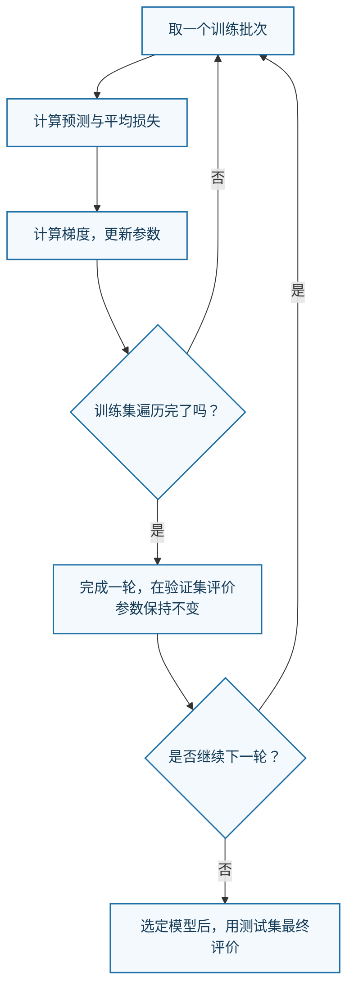

# 平均损失与小批量训练：参数怎样持续更新

**2026-11-27 · 机器学习基础**

[← 全部记录](../README.md) · [成果档案](../../showcase/README.md)

## 今天的问题

承接上一段学习给出的平均损失例题：一次参数更新后，有一个样本的损失上升，能否据此判断更新失败？随后继续学习数据分批后的参数更新，以及训练阶段与验证阶段的区别。

## 例题与条件

同一个模型用共享的参数处理两个训练样本。每个样本权重相同，一次更新前后的损失如下，数值是教学示例，不是实际训练结果。

| 样本 | 更新前的损失 | 更新后的损失 |
| --- | ---: | ---: |
| A | 4 | 1 |
| B | 1 | 2 |
| 平均损失 | 2.5 | 1.5 |

平均损失是各样本损失之和除以样本数量。本题中，B 变差，但两个样本的平均损失下降。

## 我的原始回答

被问到是否同意“B 的损失变大了，所以这次参数更新失败了”时：

> 不同意，因为需要看总体的，某个样本可能会出现效果变差的可能

## 课堂核对与补充

判断正确。“总体”在本题中具体指这组训练样本的平均损失。它从 2.5 降到 1.5，说明这个整体训练目标改善了。

同一组参数会影响多个样本，更新时不要求每个样本的损失都同时下降。参数更新可以依据当前参与训练的一组样本的平均损失梯度进行。

这个结论针对题目中的训练样本；新数据上的表现仍需要独立数据检查。

## 小批量训练：下一批使用什么参数

另一个教学例子：训练集有 12 张图片，每批取 4 张，每处理一批就更新一次参数。

| 批次 | 图片 | 参数变化 |
| --- | --- | --- |
| 第 1 批 | 第 1～4 张 | 从初始参数开始，更新一次 |
| 第 2 批 | 第 5～8 张 | 接着第 1 批更新后的参数，再更新一次 |
| 第 3 批 | 第 9～12 张 | 接着第 2 批更新后的参数，再更新一次 |

- Batch 是一次参与计算的一组样本，本例每批 4 张。
- Step 在本例中指一次参数更新。
- Epoch 是把整个训练集遍历一遍，本例一轮包含 3 次参数更新。

以上按每批更新一次的基础训练流程说明。

### 我的原始回答

被问到第 2 批应从初始参数开始，还是接着第 1 批更新后的参数继续时：

> 第一批的参数，因为需要不断地迭代更新参数，从而让整体目标得到改善

判断正确。这里具体指第一批更新后的参数，各批次持续影响同一个模型。每次更新依据当前批次的损失，整个训练集的损失不一定每一步都下降。

## 训练与验证：都能计算损失，作用不同

| 操作 | 训练阶段 | 验证阶段 |
| --- | --- | --- |
| 输入图片，得到预测 | 是 | 是 |
| 对照真实标签，计算损失或准确率 | 是 | 是 |
| 根据这批数据的梯度更新参数 | 是 | 否 |

验证结果可以帮助选择模型和训练设置；模型参数通过训练数据更新。

### 我的原始回答

被问到直接用验证集计算梯度、更新参数，再用更新后的验证成绩证明泛化能力有什么问题时：

> 这样验证集就变为了训练集，我们无法从验证集上得出我们的泛化能力等等

判断正确。这份数据已经参与参数训练，其分数仍可描述模型对这些数据的表现，但失去了作为独立验证结果的作用。后续需要用没有参与该训练或选择过程的数据进行独立评价。

## 把训练流程串起来

## 与前面知识的联系

一组样本产生各自的预测和损失，计算平均损失后，再根据它的梯度与学习率更新共享参数。

[前一日：准确率、损失、参数与梯度](2026-11-26.md)

## 证据与后续验证

- 已完成：指出不能因一个样本变差，就否定平均损失下降的更新。
- 已完成：判断下一批继续使用上一批更新后的参数，并说明迭代更新的目的。
- 已完成：指出直接用验证数据更新参数，会使其失去独立验证的作用。
- 已整理：共享参数、平均损失、batch、step、epoch 与验证阶段的关系。
- 后续验证：在一个新情境里解释完整流程，再用小实验对照实际运行。

## 下一步

从单个参数走向多个输入：模型中的特征、权重和偏置分别是什么？
