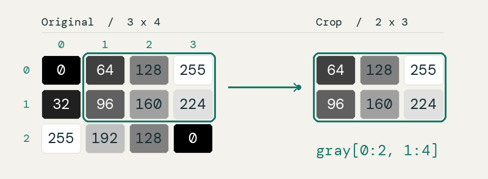

# 我的成果与成长

[← 返回首页](../README.md)

这里保存已经有证据的理解和作品。每项成果说明完成了什么，以及还没有验证什么。

## 理解图片的数字表示

**状态：基础回答已核对 · 类型：概念理解与课程示例**

- 已有证据：正确解释像素索引、二维裁剪结果与数组形状。
- 修正记录：矩形区域的像素数量判断正确，起止索引偏移已纠正。
- 配套材料：可运行的图片生成、读取与裁剪示例。
- 继续验证：独立完成并保存自己的矩形图片。

[完整过程](../journal/2026/2026-11-16.md) · [示例代码](../numpy_basic/lesson01_image_arrays.py)

## 解释为什么优先考虑模型 B

**状态：判断与理由已核对 · 类型：理论学习**

- 已有证据：能够把模型选择与未见过的数据联系起来。
- 整理补充：训练、验证和测试的职责，以及分布变化带来的局限。
- 继续验证：亲自完成一次数据划分与模型评价的小实验。

[本人回答与完整过程](../journal/2026/2026-11-24.md)

## 判断欠拟合与过拟合

**状态：两道教学例题的判断已核对 · 类型：理论学习**

- 已有证据：在例题条件下，正确区分欠拟合、过拟合和表现较合适的模型。
- 已有证据：选择验证准确率更高的第 30 轮，指出继续训练至第 80 轮出现过拟合。
- 整理补充：训练与验证的差距小，也需要结合分数本身判断。
- 继续验证：亲自用一个小实验观察训练与验证表现的变化。

[两次原始回答与题目](../journal/2026/2026-11-25.md)

## 区分准确率与交叉熵损失

**状态：教学判断已核对，表述已整理修正 · 类型：理论学习**

- 已有证据：判断给真实类别更低概率的模型，交叉熵损失更大。
- 已有回答：类别判断不变时，准确率不变，损失仍可能下降。
- 表述修正：例题比较同一个样本前后的损失值，按真实类别的预测概率计算。
- 继续学习：在单参数例子中选择能减小损失的调整方向，并指出步长需要控制；数值计算由讲解提供。
- 配套图示：[小步调整与调整过大的对比](../assets/images/parameter-loss.png)。
- 继续验证：理解梯度与更新公式，计算多个样本的平均损失。

[原始回答、公式与方向判断](../journal/2026/2026-11-26.md)

## 计划中的作品

下面各项尚未完成，等有实际结果后再增加独立报告。

| 作品 | 想回答的问题 | 准备保留的证据 |
| --- | --- | --- |
| 第一份分类实验报告 | 一次完整的训练与评价怎样进行？ | 数据说明、划分、真实结果、运行方法 |
| 海洋生物图像识别记录 | 哪些类别能分清，哪些容易混淆？ | 类别定义、预测与标签对照、错误样本 |
| 完整画面的检测观察 | 对象有没有找到，类别与位置是否合适？ | 标注和预测图、漏检与错分记录、评价条件 |

分类实验先从教学数据开始。海洋生物图像尚未选定，检测部分也尚未开始。首页的 NOAA 照片用于说明观察问题，不是模型输出。

完成后使用[成果模板](../templates/result.md)增加独立报告。每份报告保留问题、数据、方法、真实结果、运行方式与失败分析，注明自己的工作和引用内容。

## 阶段总结

| 维度 | 当前证据 | 下一步 |
| --- | --- | --- |
| 理论理解 | 已完成模型选择、拟合情况、损失大小与更新幅度的教学判断 | 梯度、学习率与参数更新 |
| 代码理解 | 已阅读数组和图片示例 | 对关键操作做小范围修改并核对 |
| 实验能力 | 课程示例已运行；独立训练实验待完成 | 完成一次可复查的小实验 |
| 表达与复盘 | 已整理四篇学习记录 | 持续保留自己的推理与纠错 |

后续每完成一个独立实验，在这里链接对应报告，再补一段阶段回顾：这次自己能独立做什么了，哪些原来的判断需要修改，还有什么没有验证。结果图和数字使用实际运行输出，并写明对应的条件。
